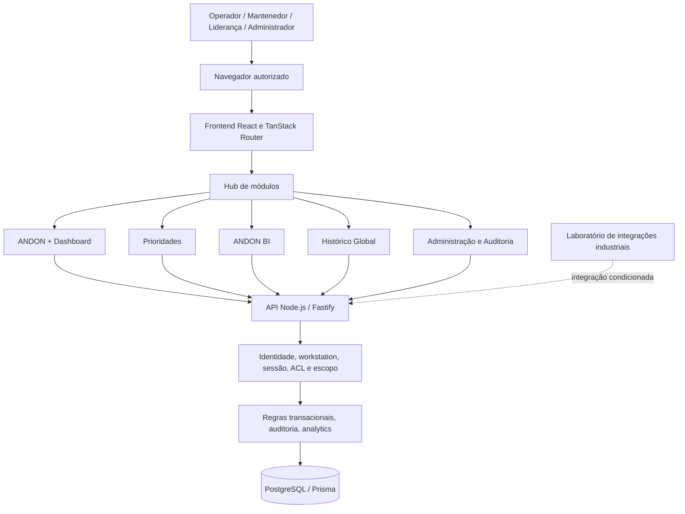

# Arquitetura vigente — ANDON Web Industrial

**Edição:** DOC 1 / fase 2, 25/11/2026  
**Referência de código:** `main@6018335c6f085757a0fd35faed8a2893f4f03e0a`, acrescida da PR documental [#654](https://github.com/projetoever/andon-evergreen/pull/654).  
**Instalador/canal:** `1.0.0-pilot.3` / piloto, conforme `release-manifest.json`.  
**Nível de evidência:** arquitetura verificada no repositório; NÃO representa certificação de rede da fábrica, instalação do SHA em terminal físico ou liberação comercial.

## 1. Visão lógica atual

A figura descreve componentes lógicos, **não** segmentos de rede, DMZ, firewall ou ligação física aprovada com CLPs. O Hub apresenta módulos efetivamente autorizados; a API decide permissões e escopo, mesmo com URL direta. Recursos de integração industrial são uma trilha isolada até homologação específica.

## 2. Stack comprovada no código

| Camada | Referência verificada | Comportamento |
|---|---|---|
| Interface | `src/`, `package.json`, `src/routes/` | React, TypeScript, Vite, TanStack Router/Start; Tailwind e componentes acessíveis |
| Navegação e segurança visual | `src/routes/__root.tsx`, `src/context/ModuleAccessProvider`, `src/components/security` | Tema/idioma, gate de workstation, resolução de módulos, UI Audit Tracker |
| Servidor de frontend compilado | `scripts/serve-frontend.mjs` | HTTP/HTTPS por configuração; artefatos `dist/client` e `dist/server` |
| API | `server/src/server.ts`, `server/src/routes/` | Node.js, Fastify, tipagem/validação, rotas operacionais e analytics |
| Controle de acesso | `server/src/access/`, `server/src/services/moduleRegistry.ts` | Sessões, contas, workstation, allowlist de ações, grants e escopo de máquina |
| Persistência | `server/prisma/schema.prisma`, `server/prisma/migrations/` | PostgreSQL via Prisma e migrações versionadas |
| Instalação | `installer/`, `install-tools/`, `release-manifest.json` | Runtime Windows e menus de atualização, saúde, recuperação e HTTPS |

**Importante:** `docker-compose.yml` na raiz usa `postgres:16-alpine` como **artefato de desenvolvimento**, com credenciais de exemplo. Não deve ser interpretado como topologia industrial homologada. O ambiente de piloto mencionado nos registros possui PostgreSQL 17; conferir versão real, imagem, porta, banco e migrações no destino antes de documentar a instalação. O manifesto não fixa uma versão detalhada do serviço PostgreSQL, mas registra motor PostgreSQL, runtime Node `22.23.2` e portas-padrão API `3001` / frontend `8080`. A versão exata da instância depende do ambiente.

## 3. Módulos e entradas

| Experiência | Caminho UI | Origem da autorização |
|---|---|---|
| Hub | `/hub` | Identidade, aprovação de estação, políticas por módulo |
| ANDON operacional | `/andon` | `andon.read` e autorização da máquina/ação |
| Machine Detail | `/machines/:machineId` | Leitura de máquina e escopo |
| Histórico por máquina | `/machines/:machineId/call-history` | Grants de histórico e escopo, conforme rota |
| Histórico Global | `/history` | Concessão composta de histórico e disponibilidade central |
| BI | `/bi` | `bi.read`, leitura filtrada por máquina |
| Prioridades | `/machine-priorities` | `priorities.read`; mudanças exigem `priorities.write` e validação adicional |
| Administração do Hub | `/hub/admin` | Contas, sessão, ação e capabilities específicas |
| Configurações ANDON | `/andon/admin` | Acesso delegado/administrativo, grants por ação |

A disponibilidade visual em um navegador **não** prova que uma operação é autorizada; consulta, escrita e exportação devem ser testadas na API.

## 4. Modelo de dados e domínio

O esquema real está em `server/prisma/schema.prisma`. Documentar com granularidades separadas:
- **Máquina e programação:** cadastro, estado, intervalo planejado e alterações históricas; programação não equivale à prioridade visual.
- **Chamado:** abertura, origem direta/grupo, setor solicitado, motivo/opção, classificação e fechamento.
- **Participação técnica:** técnicos e sessões/fases independentes; a soma de horas-pessoa não se converte automaticamente em downtime.
- **Parada física:** eventos/episódios por máquina e intervalos de impacto associados; evitar dupla contagem na união temporal.
- **Auditoria:** mutações de negócio com ator/contexto; telemetria de navegação/cliques é informativa e pode ser incompleta.
- **Priorização:** ordem/rank, configuração global do número de destaques, histórico de alterações e concorrência otimista.
- **Acesso:** usuários, sessões, grants, limites de máquina, workstations e revogações.

Não renomear entidades de forma especulativa em API ou banco. Conferir a coluna e o modelo exato antes de publicar um dicionário formal de dados.

## 5. Dependências operacionais e limites

A operação normal depende do frontend, API e PostgreSQL estarem saudáveis; HTTPS e cadeias de confiança devem ser configurados pelo perfil escolhido, sem relaxar autenticação para resolver conectividade. Falha transitória de rede deve gerar recuperação controlada, nunca permissão artificial. Os controles de auditoria do Hub usam eventos existentes, incluindo eventos de UI que não comprovam escrita concluída.

O acesso real em Android/iOS, o cenário Firefox com sessão persistente, a restauração de backup e a comunicação em rede industrial ainda exigem homologação física da candidata de release. Este documento não autoriza deploy.

## 6. Referências normativas internas

- [Marco DOC 1](DOC1_MARCO_20261125.md)
- [Inventário de permissões e rotas](DOC1_AUTORIZACAO_MODULOS_20261125.md)
- [Matriz de aceite](DOC1_HOMOLOGACAO_GUIADA_20261125.md)
- [Metodologia BI](BI_METODOLOGIA_E_QUALIDADE.md)
- [Plano de documentação](DOC1_PLANO_ENTREGAVEL_20261125.md)
- `release-manifest.json`, `server/src/server.ts`, `server/src/access/policy.ts`, `server/src/services/moduleRegistry.ts`
