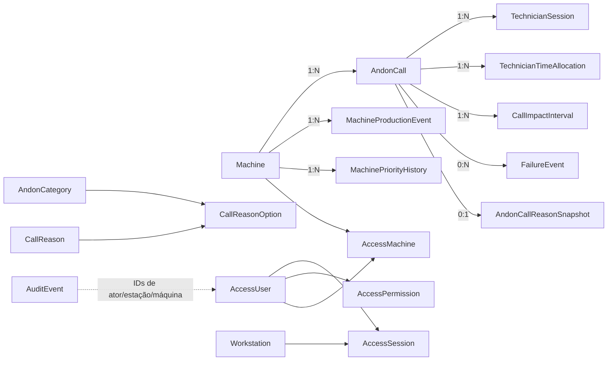

# DOC 1 — Dicionário de dados e mapa de domínios

**Documento:** DOC1-DAD-001 · versão 0.1 · 25/11/2026  
**Código de referência:** `main@c7c7837b77be4ce9e1d817913ff921e3f38413d4` (alterações técnicas apenas documentais após `6018335c...`).  
**Fonte vinculante:** [`server/prisma/schema.prisma`](../server/prisma/schema.prisma); rotas e serviços do backend complementam a semântica de cada campo.  
**Estado:** inventário de *schema*, **não** prova de migração aplicada no banco industrial. Classificação: documentação de engenharia sem dados reais.

## 1. Visão de domínio

O schema Prisma contém **36 modelos** distribuídos entre cadastro, fluxo operacional, tempos/impacto, analytics de produção, acesso e trilha de auditoria.

As ligações tracejadas indicam apenas campos de correlação, **não** necessariamente constraints de chave estrangeira. A cardinalidade de `FailureEvent.callId` é opcional: não pressupor 1:1 entre chamado e falha física.

## 2. Inventário completo por grupos

| Grupo | Modelos Prisma |
|---|---|
| Configuração | `SystemSettings`, `DashboardPriorityConfig`, `ModuleCredential` |
| Máquinas, ativos e catálogos | `Machine`, `AndonCategory`, `CallReason`, `CallReasonOption`, `MachineSetType`, `MachineSubsetType`, `MachineSet`, `MachineSubset`, `FailureClassification`, `Shift`, `WorkstationMachineSoundPreference` |
| Chamados, tempos e impacto | `AndonCall`, `AndonCallReasonSnapshot`, `TechnicianSession`, `TechnicianTimeAllocation`, `FailureEvent`, `CallImpactInterval`, `MachineProductionEvent`, `Technician`, `TechnicianTechnicalArea`, `FailureDiagnosisAudit` |
| Prioridades | `MachinePriorityHistory` |
| Acesso e dispositivos | `Workstation`, `WorkstationAdmission`, `AccessUser`, `AccessPermission`, `AccessMachine`, `AccessSession`, `KioskDevice`, `KioskTrustLease`, `IndustrialServiceIdentity`, `IndustrialServiceSession` |
| Auditoria | `AuditEvent` |

**Conferência de quantidade:** 3 (configuração) + 11 (máquinas/catálogos) + 10 (chamados/tempos) + 1 (prioridades) + 10 (acesso/dispositivos) + 1 (auditoria) = **36 modelos**. Modelos não representam automaticamente tabelas com os mesmos nomes; conferir as diretivas `@@map`.

## 3. Entidades operacionais — chaves, campos e responsabilidades

| Modelo / tabela física | Campos-chave reais | Granularidade / regra |
|---|---|---|
| `Machine` | `id`, `name`, `isActive`, `machineStatus`, `andonStatus`, `productionMode`, `requireWorkOrderAtOpen`, `hiddenDirectSectorIds`, `priorityOrder`, `currentCallId` | Uma máquina cadastrada; estados e preferências globais não implicam episódio de parada |
| `AndonCategory` | `id`, `displayName`, `categoryGroup`, `active`, `showDirectButton`, `displayOrder` | Setor/área exibida; participação no grupo e visibilidade direta são conceitos distintos |
| `CallReason` | `id`, `displayName`, `nature`, `suggestedResponsibility`, `maintenanceKpiPolicy`, `analyticsDisposition`, `revision` | Motivo configurável versionado e política analítica sugerida |
| `CallReasonOption` | `id`, `reasonId`, `technicalAreaId`, `natureOverride`, `maintenanceKpiPolicyOverride`, `analyticsDispositionOverride`, `revision` | Associação motivo ↔ área técnica; revisar override e revisão na abertura |
| `AndonCall` / `andon_calls` | `id`, `machineId`, `category`, `subtype`, `origin`, `status`, `workOrderNumber`, `criticality`, `openedAt`, `attendedAt`, `maintenanceCompletedAt`, `finishedAt` | Um chamado lógico com transições; **não equivale a uma falha física** |
| `AndonCallReasonSnapshot` / `andon_call_reason_snapshots` | `callId`, `reasonId`, `optionId`, nomes/revisões snapshot, `nature`, `maintenanceKpiPolicy`, `analyticsDisposition` | Fotografia da regra de abertura para preservar significado histórico após edição de catálogo |
| `TechnicianSession` | `callId`, `machineId`, `technicianId`, `technicianName`, `phase`, `cycleIndex`, `startedAt`, `endedAt`, `endReason` | Sessão/fase de um técnico; pode se sobrepor a outra |
| `TechnicianTimeAllocation` | `callId`, `technicianName`, `technicianId`, `startedAt`, `endedAt`, `totalSeconds`, `source` | Alocação de tempo por identidade; não confundir com parada global |
| `FailureEvent` | `machineId`, `callId?`, `startedAt`, `endedAt`, `durationSeconds`, `failureResponsibility`, `analyticsDisposition` | Evento de condição/parada física, sujeito à união de intervalos por máquina |
| `CallImpactInterval` | `callId`, `machineId`, `startedAt`, `endedAt`, `durationSeconds`, `assignedByCallId` | Intervalo de atribuição de impacto à máquina e ao chamado |
| `MachineProductionEvent` | `machineId`, `productionMode`, `startedAt`, `endedAt`, `durationSeconds` | Linha do tempo de condição programada/não programada |
| `MachinePriorityHistory` | `machineId`, `previousOrder`, `newOrder`, `previousPriorityRank`, `newPriorityRank`, `changedAt`, `source` | Histórico de ordenação e ranking; mudanças de destaque são também auditáveis |

`AndonCall` possui ainda `callWaitingMinutes`, `attendanceMinutes`, `postMaintenanceMinutes`, `totalCallMinutes`, `machineStoppedMinutes`, `maintenanceReturnCount`, `isSystemTest`, `failureClassification`, `failureResponsibility` e `analyticsDisposition`. Estes são campos **distintos**; verificar suas fontes de cálculo e o momento do congelamento antes de compará-los. Dados de conjunto/subconjunto têm referências de abertura e de confirmação com snapshots de ID/código/nome/tipo; não apagar histórico ao alterar catálogos.

## 4. Configuração, prioridades e acesso

| Modelo | Campos centrais | Semântica e observação |
|---|---|---|
| `SystemSettings` / `system_settings` | `requireWorkOrderAtOpen`, `preventDuplicateWorkOrderNumbers`, `restrictMaintenanceCompletionToAttendanceWorkstation`, `virtualKeyboardEnabled`, `dashboardMachineOrderMode`, `andonVisualPalette`, `hubEnabled` | Configuração global; não inferir override por máquina sem ler a regra específica |
| `DashboardPriorityConfig` / `dashboard_priority_config` | `priorityHighlightCount`, `lastOrderUpdatedAt`, `lastOrderUpdatedBy` | Contagem global de destaques, padrão 5; migração `20261125173000_priority_highlight_count` requer execução autorizada no destino |
| `Workstation` | `id`, `pendingApproval`, `active`, `lastSeenAt`, `lastHeartbeatAt`, `lockedMachineId` | Identidade e admissão de terminal; “última vista” não equivale a conexão ativa contínua |
| `AccessUser` | `id`, `login`, `displayName`, `accountType`, `isPrimaryAdmin`, `machineScope`, `sessionPolicy`, `authorizationVersion` | Identidade e capacidades; rótulo `roleLabel` não autoriza mutações por si só |
| `AccessPermission`, `AccessMachine` | `userId`, `machineId` / permissão | Relações de capacidade e escopo |
| `AccessSession` / `access_sessions` | `tokenHash`, `userId`, `workstationId`, `purpose`, `expiresAt`, `revokedAt`, `persistentOperational` | Sessão persistente no banco, passível de revogação; **nunca registrar token ou hash em manuais** |
| `AuditEvent` / `audit_events` | `occurredAt`, `action`, `resourceType`, `resourceId`, `machineId`, `result`, `before`, `after` | Trilha de evento, com dados sensíveis a redigir na leitura e exportação |
| `FailureDiagnosisAudit` | `callId`, `machineId`, valores anteriores/posteriores, `createdAt` | Evidência específica de alteração do diagnóstico, distinta da telemetria UI |

**Campos sensíveis:** `passwordHash`, `pinHash`, `tagHash`, `tokenHash`, `adminRecoveryCodeHash`, `managerPasswordHash`, segredos de identidade industrial, IP e campos auditáveis `before/after`. O inventário pode citar a *existência* desses campos, mas exportações, exemplos e capturas jamais devem incluir seus valores reais.

## 5. Invariantes analíticos

1. Um `AndonCall` pode ter vários `TechnicianSession`; horas-pessoa não constituem downtime físico.
2. Falhas físicas devem ser unidas temporalmente por máquina quando houver sobreposição; não multiplicar por chamados ou técnicos.
3. A classificação final e os snapshots do motivo podem divergir por evolução do atendimento. Preservar ambos e suas datas.
4. A produção programada exige cobertura histórica consistente para disponibilidade/MTBF. `Machine.productionMode` corrente sozinho não prova a programação passada.
5. Evento `isSystemTest` não deve se tornar manutenção real por simples mudança de filtro.
6. `maintenanceReturnCount` pertence a um chamado e não transforma retorno no mesmo chamado em nova falha.
7. Migrações existentes no repositório não provam que foram aplicadas ao banco de destino; comparar `_prisma_migrations` no ambiente autorizado.

## 6. Critérios antes de congelar o dicionário definitivo

- Gerar diagrama ER completo a partir do schema do SHA final e verificar integridade referencial/índices.
- Confirmar enumerações admitidas de campos `String` nos validadores e serviços; **não** inventar valores de status a partir de nomes de coluna.
- Exportar somente esquema e estatísticas agregadas sanitizadas do banco **isolado**; não expor backups ou dados fabris.
- Associar cada campo de relatório ao endpoint/query e ao cálculo correspondente.
- Revisar migrações, defaults e compatibilidade de versões de PostgreSQL.
- Validar relações legadas e valores nulos com uma massa de teste, mantendo desconhecido distinto de zero.

## Fontes de código

[`server/prisma/schema.prisma`](../server/prisma/schema.prisma) · [`server/src/analytics`](../server/src/analytics) · [`server/src/routes/andonCalls.ts`](../server/src/routes/andonCalls.ts) · [`server/src/access`](../server/src/access) · [`DOC1-QA`](DOC1_HOMOLOGACAO_GUIADA_20261125.md).
