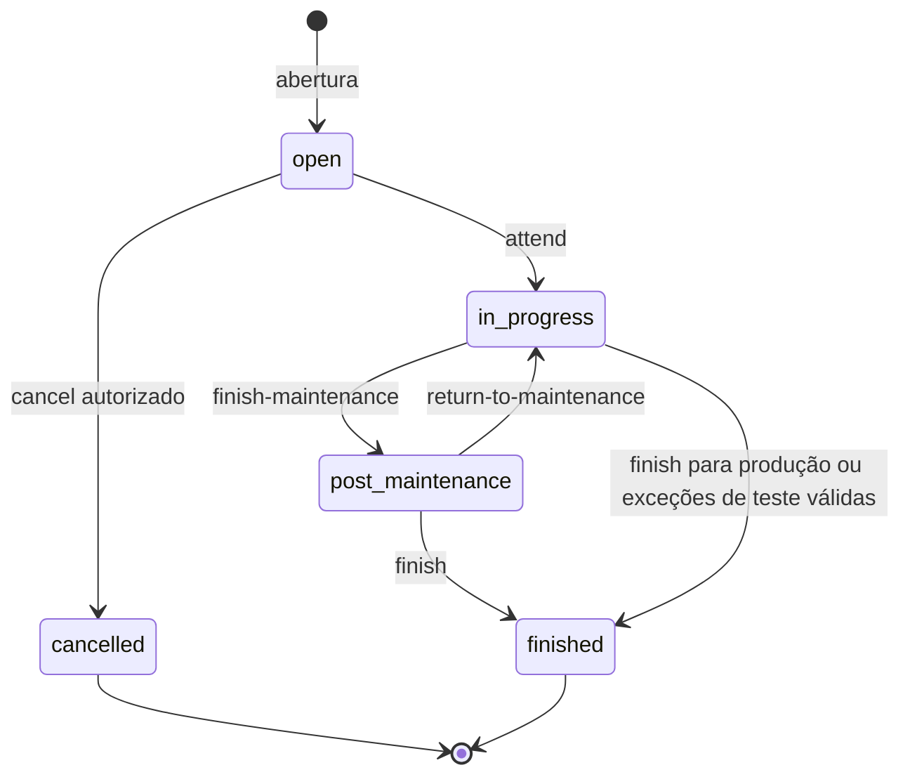

# DOC 1 — Contrato de fluxos: chamados, grupos, atendimento e histórico

**Documento:** DOC1-OPS-001 · Edição 0.1 · 25/11/2026  
**Referência:** `main@c7c7837b77be4ce9e1d817913ff921e3f38413d4` (somente mudanças documentais após o baseline funcional `6018335c...`).  
**Fontes:** `server/src/routes/andonCalls.ts`, `server/src/services/groupBatchOpening.ts`, `server/src/access/`, `server/prisma/schema.prisma`.  
**Escopo:** especificação técnica para preparar os manuais e testes; **não é certificação de que todos os casos foram homologados em fábrica**.

## 1. Unidade de trabalho e contexto

- **Máquina**: cadastro e estado atual, programação e preferências; seu estado corrente não é medição histórica de perda.
- **Setor/área técnica (`AndonCategory`)**: destino técnico do chamado, com rótulo, cor, ordem e exibição direta. A ocultação do botão de setor não elimina seu cadastro.
- **Motivo/opção**: `CallReason` e `CallReasonOption` vinculados à área técnica, revisões, responsabilidade sugerida e política analítica; snapshot no chamado preserva regra aplicada na abertura.
- **Grupo de chamados**: seleção organizada de vários setores sob regra de abertura em lote; o grupo **não** cria um novo setor físico nem apaga setores anteriores.
- **Chamado (`AndonCall`)**: ocorrência lógica com ciclo operacional e eventual OS; pode incluir técnicos múltiplos, fases, retorno e impacto produtivo.
- **Parada física**: eventos `FailureEvent` e intervalos `CallImpactInterval`; podem sobrepor outros registros. Não somar chamados como minutos de downtime.
- **Histórico e auditoria**: cronologia funcional e eventos de alteração comprovada; um clique de interface é telemetria e não confirma persistência de uma mudança.

## 2. Máquina de estados persistidos

A rota operacional utiliza os valores de `AndonCall.status` abaixo; o campo é `String` no Prisma e a validade de transição depende dos handlers, não de um enum de banco.

O diagrama é a **visão de fluxo funcional**. Chamados reais de **manutenção** devem passar por `post_maintenance` antes de `finish`; os reais de **produção** exigem `in_progress` para finalizar. Chamados de teste seguem guardas próprias. Não pressupor que todos os perfis possam finalizar diretamente de qualquer estado. Verificações de terminal de atendimento, descrição de falha, identidade, natureza do motivo e momento de parada podem restringir as transições. O cancelamento em outras fases, caso suportado pelo handler, deve ser homologado especificamente antes de constar no manual.

### Valores verificados

| Status persistido | Significado operacional | Fontes de tempo |
|---|---|---|
| `open` | Chamado aberto, aguardando primeiro atendimento | `openedAt`; MTTA somente após `attendedAt` válido |
| `in_progress` | Atendimento técnico iniciado/em curso | `attendedAt`, `currentAttendanceStartedAt`, `TechnicianSession` |
| `post_maintenance` | Atendimento técnico encerrado, em fase de acompanhamento/validação | `maintenanceCompletedAt`, `postMaintenanceMinutes` |
| `finished` | Chamado concluído conforme regras do fechamento | `finishedAt`, durações congeladas e diagnóstico |
| `cancelled` | Cancelamento registrado, com motivo e autorização aplicáveis | `cancelReason`, histórico de ação |

Não inferir disponibilidade, produção programada, setor causal ou elegibilidade MTTR apenas pelo status.

## 3. Contrato HTTP operacional verificado

| Operação | Método e rota | Autorizações e riscos |
|---|---|---|
| Listar ocorrências | `GET /api/andon-calls` | `andon.read`, escopo de máquina |
| Histórico simples | `GET /api/andon-calls/history` | `history.read`, filtros no backend |
| Pesquisar histórico | `GET /api/andon-calls/history/search` | Regras de histórico global e de escopo |
| Exportar histórico | `GET /api/andon-calls/history/export` | Exportação restrita; nunca assumir autorização só pela UI |
| Resumo/detalhe | `GET /api/andon-calls/history/summary` e `GET /api/andon-calls/history/detail/:callId` | Resolver máquina do registro e validar grant |
| Abrir chamado | `POST /api/andon-calls` | `calls.open`, OS e duplicidade, setor/motivo, máquina ativa |
| Abrir grupo/lote | `POST /api/andon-calls/batch` | `calls.open`, conjunto de setores permitido, atomicidade |
| Iniciar atendimento | `PATCH /api/andon-calls/:id/attend` | `calls.attend`, verificação de técnico/identidade, exclusividade |
| Acrescentar técnico | `POST /api/andon-calls/:id/technicians` | `calls.technicians.manage`, validação de identidade |
| Encerrar técnico | `PATCH /api/andon-calls/:id/technicians/:technicianName/end` | `calls.technicians.manage`, efeito sobre último atendente |
| Encerrar técnicos em lote | `PATCH /api/andon-calls/:id/technicians/end` | Gate específico de múltiplos técnicos |
| Encerrar manutenção | `PATCH /api/andon-calls/:id/finish-maintenance` | `calls.finishMaintenance`, término da fase técnica |
| Retornar à manutenção | `PATCH /api/andon-calls/:id/return-to-maintenance` | `calls.returnToMaintenance`, contador de retorno |
| Finalizar chamado | `PATCH /api/andon-calls/:id/finish` | `calls.finish`, motivo/diagnóstico/impacto conforme natureza |
| Corrigir diagnóstico | `PATCH /api/andon-calls/:id/failure-details` | `diagnosis.edit`, PIN/etapa quando exigidos, log |
| Cancelar | `PATCH /api/andon-calls/:id/cancel` | Propriedade e `calls.cancel.own`/`calls.cancel.any`; **não** basta grant fixo do registry |

A tabela é um inventário **real de caminhos** extraídos de `andonCalls.ts`, mas não é contrato de campos completo. Para futuros tutoriais, conferir o schema de cada body e a condição do modo central/legado.

## 4. Regras críticas a registrar nos tutoriais

### A. Abertura direta
1. Selecionar uma máquina disponível à sessão e ao escopo.
2. Selecionar setor/motivo/opção conforme a configuração vigente e o painel apresentado.
3. Fornecer OS quando a política global ou específica da máquina exigir; validar bloqueio de OS repetida quando ativado.
4. Confirmar criação e verificar ID, setor solicitado, snapshot do motivo e estado `open`.
5. Em caso de conflito/timeout, consultar estado antes de tentar de novo; evitar dupla criação.

### B. Abertura por grupo
1. Selecionar grupo cadastrado e verificar setores elegíveis.
2. Se já existir chamado ativo para algum setor, não criar segunda ocorrência desse setor.
3. O backend recebe seleções com `reasonId`, `optionId`, `expectedReasonRevision`, `expectedOptionRevision` e `subtype`; o parser de lote valida chaves e combinações.
4. A abertura deve ser testada com múltiplos setores, seleção parcial, revisão obsoleta e rede intermitente.
5. Registrar identidade **setor — grupo** onde a UI permitir e preservar essa origem no histórico; a política analítica de um motivo/grupo é verificada pelos snapshots, não por inferência do nome.

### C. Atendimento com um ou mais técnicos
1. A primeira entrada de técnico inicia `attendedAt` e a fase `in_progress`.
2. Adições de técnicos podem criar períodos simultâneos; o sistema deve conservar sessões independentes e a identificação.
3. Encerrar um técnico individualmente não equivale a fechar a ocorrência; testar especialmente a regra do último técnico.
4. A conclusão da manutenção pode iniciar `post_maintenance` sem concluir o chamado.
5. Em retorno, `maintenanceReturnCount` cresce quando a transição é realmente executada. Repetições/retries não devem gerar duas contagens.
6. Para concluir, confirmar campos exigidos de diagnóstico, impacto de parada, OS e identidade; a API deve rejeitar estado inválido sem escrita parcial.

### D. Impacto produtivo
- A condição “máquina parada” envolve `FailureEvent` e `CallImpactInterval`; o evento de parada pode coexistir com dois chamados.
- O tempo do técnico e o tempo físico têm relógios, granularidades e regras diferentes.
- A atribuição à manutenção depende do diagnóstico e da regra de responsabilidade, não apenas do nome “Elétrica” ou “Mecânica”.
- O fechamento não pode inventar impacto “sem parada” quando o registro causal estiver pendente.
- A soma do downtime deve unir intervalos sobrepostos da **mesma máquina** para não multiplicar perdas.

## 5. Exemplo sintético de rastreabilidade

Uma máquina fictícia possui um chamado de Elétrica aberto às 10:00; T1 começa às 10:04, T2 às 10:09. T1 e T2 trabalham simultaneamente de 10:09 a 10:16, a manutenção termina às 10:20 e o chamado encerra às 10:25.  
**Consequências documentais:** MTTA de exemplo pode partir da primeira entrada (4 minutos), a duração de atendimento não é a soma de T1 e T2, o acompanhamento é o intervalo pós-manutenção de 5 minutos se aplicável, e a parada física só pode ser calculada se existirem eventos válidos de condição da máquina. **Os horários ilustrativos não são evidência de um chamado real, não geram valor oficial de KPI e não definem as fórmulas completas.**

## 6. Plano de aceitação para este contrato

| ID | Verificação | Reprovação quando... |
|---|---|---|
| OPS-01 | Abertura direta, OS exigida e duplicação | Duas ocorrências resultantes do mesmo retry |
| OPS-02 | Lote com dois setores, um ocupado | Setor ocupado cria chamado indevido |
| OPS-03 | Setor oculto em grupo, reload e outra estação | Some um chamado ativo ou aparece botão indevido |
| OPS-04 | Dois técnicos e uma fase simultânea | Duas horas-pessoa viram dupla parada física |
| OPS-05 | Encerrar individualmente o último técnico | Transição ocorre sem regra/consentimento exigidos |
| OPS-06 | Fim de manutenção, retorno e novo encerramento | Contador de retorno incorreto ou tempo negativo |
| OPS-07 | Falha com parada confirmada e sem impacto | Indicador de parada é fabricado ou perdido |
| OPS-08 | Diagnóstico pendente e edição posterior autorizada | Histórico/snapshot é apagado ou ACL é ignorada |
| OPS-09 | Cancelamento por próprio/terceiro e usuário sem grant | API admite cancelamento indevido |
| OPS-10 | Histórico global e por máquina com escopo parcial | Vazamento de dados por URL, filtro ou CSV |

**Estado desta edição:** casos especificados, **não executados**. Vincular cada um aos critérios [DOC1-QA](DOC1_HOMOLOGACAO_GUIADA_20261125.md) antes de declarar comportamento homologado.

## Fontes
[`andonCalls.ts`](../server/src/routes/andonCalls.ts) · [`groupBatchOpening.ts`](../server/src/services/groupBatchOpening.ts) · [`schema.prisma`](../server/prisma/schema.prisma) · [`policy.ts`](../server/src/access/policy.ts) · [`DOC1-DAD`](DOC1_DICIONARIO_DADOS_20261125.md).
